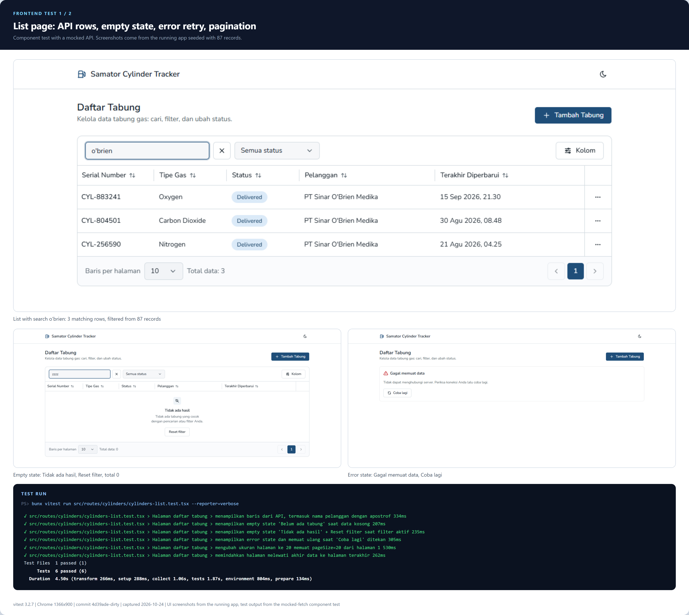
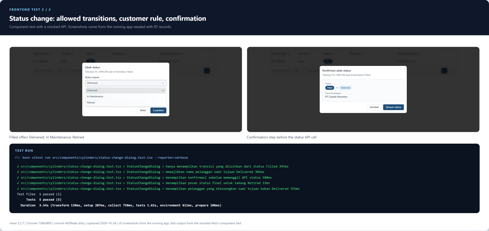
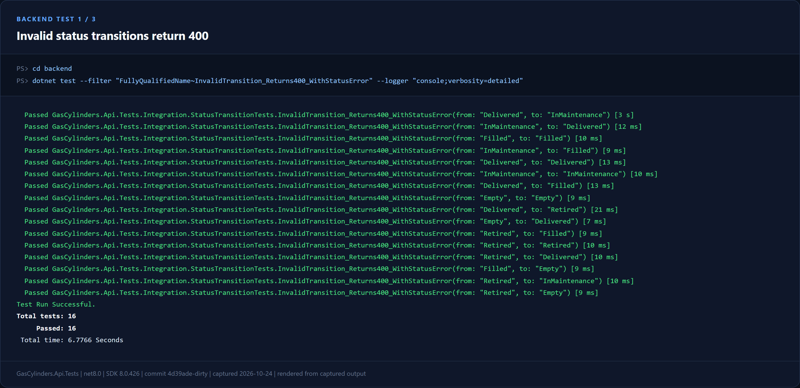
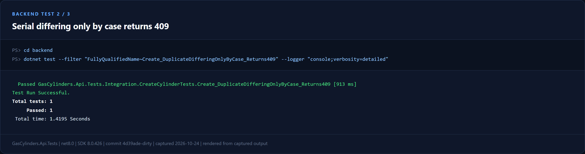
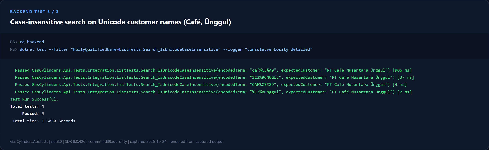

# Gas Cylinder Tracker

Internal web app for tracking the lifecycle of Samator gas cylinders
(fill → deliver → return empty → refill / maintenance → retire), built for the
**Samator Group Technical Assignment** (brief provided by HR).

- **Frontend:** React 19 SPA (Vite 7, TanStack Router + TanStack Query, shadcn/ui, Tailwind CSS 4, react-hook-form + zod).
- **Backend:** ASP.NET Core Web API (.NET 8), EF Core 8, SQLite, seeded from `docs/data.json` (87 records).
- **Tests:** vitest + Testing Library (frontend), xUnit integration + unit tests (backend).

```
backend/     GasCylinders.Api (Web API) + GasCylinders.Api.Tests (xUnit)
web/         React SPA
Dockerfile   single image: API serves the built SPA
infra/       docker-compose.yml
docs/        data.json, test-evidence/ (screenshots + commands)
global.json  pins the .NET 8 SDK
```

---

## 1. Setup & running

### Prerequisites

| Tool | Version |
|---|---|
| bun | 1.x (Node 20+ also works for the web app via `npx`) |
| .NET SDK | 8.0 (8.0.100 or later 8.0.x, pinned by `global.json`). Projects target `net8.0` and run only on the .NET 8 runtime |
| Docker | optional, for the single-image deployment |

### Run locally (two terminals)

```bash
# 1) API  -> http://localhost:5080  (Swagger: http://localhost:5080/swagger)
cd backend
dotnet run --project GasCylinders.Api

# 2) Web  -> http://localhost:3000  (proxies /api to :5080)
cd web
bun install
bun run dev
```

On first start the API creates `backend/GasCylinders.Api/data/cylinders.db`, applies the existing
migrations, and imports `docs/data.json` when the table is empty. Delete the `.db` file (and any
`.db-wal` / `.db-shm` files) to re-seed. Running the app does not require the EF command-line tool.

If the API runs somewhere other than `http://localhost:5080`:

```bash
API_PROXY_TARGET=http://host:port bun run dev
```

```powershell
$env:API_PROXY_TARGET='http://host:port'; bun run dev
```

### Database migrations (only when changing the model)

Migrations are applied automatically at startup. `dotnet-ef` is a local tool pinned to 8.0.32 in
`backend/.config/dotnet-tools.json`, so a fresh clone needs one restore. Run the commands from
`backend/`, where the manifest is discovered.

```bash
cd backend
dotnet tool restore
dotnet ef migrations add Name --project GasCylinders.Api --output-dir Persistence/Migrations
```

### Tests

On a fresh clone, generate `web/src/routeTree.gen.ts` before the frontend tests. That file is
gitignored, and `bun run test` does not generate it. `bun run check` is not read-only: it rewrites
formatting through `biome check --write`.

```bash
cd backend && dotnet test               # backend unit + integration tests
cd web && bun run gen && bun run test   # generate routes, then frontend tests
cd web && bun run check                 # route gen + biome --write + tsc + design lint
cd web && bun run build                 # production build
```

### Docker (production-like, one origin)

```bash
docker compose -f infra/docker-compose.yml up --build
# http://localhost:8080  (SPA + /api on the same port, SQLite in volume gas-cylinders-data)
```

---

## 2. Key design decisions

**The API is a small supporting layer for the UI. This was my first ASP.NET Core project.** The routes
follow the brief exactly, with two read-only additions: `GET /api/cylinders/meta` (gas types, statuses
and the transition table, so the UI cannot drift from the server rules) and `GET /api/health`.

Frontend
- **URL is the state.** `search`, `status`, `page`, `pageSize`, `sortBy` and `sortDir` are zod-validated
  search params. Bad values fall back to defaults, and links can be shared. Typing in search is debounced
  (300 ms) and resets to page 1.
- **Server pagination** through the shared `DataTable` (server mode), using `totalCount` from the API.
- **Multi-select status filter** (extension): the PDF only requires a single status dropdown, but
  warehouse operators often need to see e.g. "Filled + Delivered" together. A faceted filter stores
  the selected statuses as a JSON array in the URL (`status=["empty","filled"]`). The API ORs the
  values and still accepts the legacy single `status=Empty`.
- **Column sorting** (extension): the PDF does not mention sorting, but a list of 87+ cylinders is
  hard to scan without it. Clicking a column title cycles ascending → descending → default order.
  Sorting is server-side, so it applies to the whole data set rather than only the visible page,
  and it resets to page 1. Ties are broken by `id` so paging stays stable.
- **Column resizing** (extension): serial numbers and customer names vary widely in length, so
  fixed-width columns waste space or truncate too aggressively. Drag the right edge of a column
  title, or focus it and use the left/right arrow keys (±16 px, double-click resets that column).
  Widths are limited to 80 to 800 px, saved in `localStorage`, and a `Reset lebar kolom` button
  appears once any column has been resized. Resizing never triggers a sort.
- **Create/Edit form** (`CylinderFormDialog`): RHF + zod mirror the server rules. After client validation
  passes, a **confirmation step** shows the values (for edit: before → after). Only confirming calls the API.
- **Status change** (`StatusChangeDialog`): only the allowed next statuses are offered, from `/meta` with
  a built-in fallback. The customer field appears and is required only for `Delivered`. It also has a
  confirmation step.
- **Server validation errors** (`ServerErrorDialog`): any 400/404/409, or a network failure, opens a modal
  with the ProblemDetails title, detail and every field error. The same errors are set on the form fields.
- **Loading / empty / error states** on every fetching screen. List: skeleton, "Belum ada tabung" versus
  "Tidak ada hasil" + Reset filter, and an error card with "Coba lagi". Detail: skeleton, 404 "Tabung
  tidak ditemukan", and an error card with retry.
- **Dirty data** is rendered as text only (no `innerHTML`). Long customer names are truncated in the table
  with the full name in a tooltip, and shown in full on the detail page.
- **Design system and accessibility.** shadcn/ui primitives on one control scale, labelled icon buttons,
  keyboard support for resizing, and focus states on every dialog. Frontend tests cover the list, both
  dialogs, the error popup, sorting and resizing.

Backend
- **Rules live in one place.** `Services/CylinderRules.cs` is pure (normalization, validation, transition
  table) and unit-tested. `CylinderService` applies it against EF Core, and controllers only map
  `ServiceResult` to HTTP.
- **Uniqueness and lifecycle.** Serials are trimmed, stored upper-case, and protected by a unique index
  with `COLLATE NOCASE`. Duplicates return 409, including the race caught by the parallel-create test.
  Every status change goes through the transition table, and `customerName` is required for `Delivered`
  and forced to `NULL` for every other status.
- **Search and concurrent edits.** Search is case-insensitive for Unicode letters (`CAFÉ` matches `café`),
  but accents are significant: `cafe` does not match `Café`, and `unggul` does not match `Ünggul`. A stored
  `SearchKey` lowercases in C# because SQLite `lower()` only folds ASCII; it does not remove diacritics.
  `lastUpdated` is an EF concurrency token, so simultaneous updates return 409 instead of silently
  overwriting each other.
- **Migrations and seed.** EF Core migrations are applied at startup. `docs/data.json` is imported once
  when the table is empty, and invalid or duplicate rows are logged and skipped instead of crashing.
- **One deployable.** In production the API also serves the built SPA from `wwwroot`, on the same origin,
  so there is no CORS and only one container. Errors are RFC 7807 ProblemDetails, including unknown
  `/api/*` routes, which never fall through to the SPA HTML.


## 3. Assumptions on unclear instructions

1. **`id` is not in `data.json`**, even though the brief says it is provided there. The seeder assigns
   ids 1..87 in file order (the row index), so ids stay stable. New cylinders get the next autoincrement id.
2. **Serial input is normalized instead of rejected.** The brief says serials are case-insensitive and
   stored in upper case, but does not say whether lower-case input or accidental whitespace should be
   rejected (400) or auto-corrected. I chose to trim and upper-case automatically, so ` cyl-123456 `
   is accepted and stored as `CYL-123456`.
3. **`gasType` is limited to the 6 listed gases** (matched case-insensitively, stored in canonical spelling),
   because the brief says "for dummy data we limit gas types to...". Any other value is a 400.
4. **Same-status transitions (`Filled -> Filled`) are invalid**, because they are not in the "allowed next" table.
5. **`customerName` sent for a non-Delivered status is ignored** (stored as `NULL`) instead of rejected. This
   keeps the UI simple and still guarantees the "NULL otherwise" rule.
6. **Invalid list parameters:** `page < 1`, `pageSize < 1`, `pageSize > 50`, non-numeric values and an unknown
   `status` all return 400. A page past the end returns 200 with empty items, as specified.
7. **Concurrent edits** of the same cylinder return 409. The brief doesn't cover this, and the check protects
   the lifecycle rules against two simultaneous writers. It does not detect a form that was opened long ago,
   because the client does not send a version back.
8. **UI language is Bahasa Indonesia**, but status values are shown with the domain names from the brief
   (Empty, Filled, Delivered, In Maintenance, Retired) so they match the API and the PDF exactly.
9. **No authentication.** The brief describes an internal tool and doesn't mention users or roles.

## 4. What I would improve with more time

A concrete per-item design (schema, endpoints, UI changes, tests and suggested order) is in
[`docs/improvements.md`](docs/improvements.md).

- **Movement history / audit trail:** a `cylinder_events` table (who, when, from → to, customer) for
  turnover and "lost asset" reports. This targets problems 4 and 5 of the brief.
- **Maintenance and retirement details:** when a cylinder moves to `In Maintenance` or `Retired`, capture what
  failed, what was repaired, who did it, and the cost, instead of only changing the status. Store these
  details on the movement event, not on the cylinder row, so the full repair history survives.
- **Delivery photo evidence:** allow a photo to be attached when a cylinder moves to `Delivered`, stored with
  the delivery event and shown on the detail page, so the recipient and the cylinder condition stay
  verifiable.
- **Master data for gas types:** move the six gas names into a `gas_types` table with `active` and sort
  metadata, so operations can add a gas without a deploy. Keep the status workflow in code, because the
  transition table is business logic, not configuration.
- **Master data for customers:** replace the free-text customer name with a dedicated `customers`
  table (ID, official business name, delivery address, contact person) and a searchable autocomplete
  combobox on status change to `Delivered`. This eliminates typos and inconsistent entity naming
  (e.g., "RS Medika" vs "R.S. Medika"), and enables precise tracking of cylinder count per client.
- **Analytics dashboard:** counts per status and gas type, idle cylinders (no change in N days), cylinders
  per customer.
- **Export to CSV / Excel from list:** allow operators to download the current filtered/searched
  table data into CSV or Excel format for quick reporting to management and external audits.
- **Authentication and roles** (e.g. warehouse vs. admin) with Entra ID/SSO, plus per-user audit.
- **Barcode/QR scanning** on mobile to change status in the field without typing serials.
- **Similar-serial warning** (e.g. Levenshtein distance 1) on create, to catch typos before they become
  "valid" duplicates.
- **Full optimistic concurrency:** a `Version` column, an `ETag` on reads, and an optional `If-Match` on
  updates, so a stale form receives 412 instead of overwriting a newer change.

## 5. Use of AI

My primary focus was frontend engineering, but I chose to deliver the full stack within the
assignment window. I used AI as a pair programmer and reviewer, not as an autopilot:

- **Frontend:** I set the UI structure, URL/query state, interaction patterns, and accessibility
  requirements. AI helped draft repetitive form schemas, component markup, and test fixtures; I
  reviewed and adjusted every change.
- **Backend:** AI helped scaffold ASP.NET Core/EF Core plumbing, migrations, and the integration-test
  factory. I chose the domain rules, reviewed the implementation, and verified the API contract.
- **Testing:** AI helped brainstorm adversarial cases (Unicode search, duplicate serials, paging
  overflow, invalid transitions) and draft repetitive assertions. I checked each case against the
  PDF and ran the frontend Vitest (including the JSDOM pointer-capture polyfills for Radix
  Select/DropdownMenu) and backend xUnit suites.
- **Evidence:** AI helped draft the Playwright/Chrome screenshot capture and the PowerShell evidence
  generator in `tests/evidence/`. The final images are reproducible from the committed scripts.

AI review also surfaced real defects: the paging integer overflow, SQLite's ASCII-only `lower()`
breaking `Café`/`Ünggul`, the `/api/*` SPA fallback, and missing concurrency handling. Each was
confirmed with a regression test.

**Ownership:** I chose the scope, lifecycle rules, UX, and assumptions, and reviewed every
AI-generated change. AI produced substantial first drafts, especially for .NET plumbing, repetitive
tests, and the evidence generator; I decided what shipped. The final result was verified with the
full frontend and backend suites, a production build, and live browser checks.


## Appendix: Test evidence

The submission images are embedded below, frontend first. Each image shows the command and the result;
the frontend images combine real UI screenshots with the vitest output.

### Frontend





### Backend







| Suite | Command |
|---|---|
| Frontend tests | `cd web && bun run test` |
| Frontend gate | `cd web && bun run check` |
| Production build | `cd web && bun run build` |
| Backend tests | `cd backend && dotnet test` |
